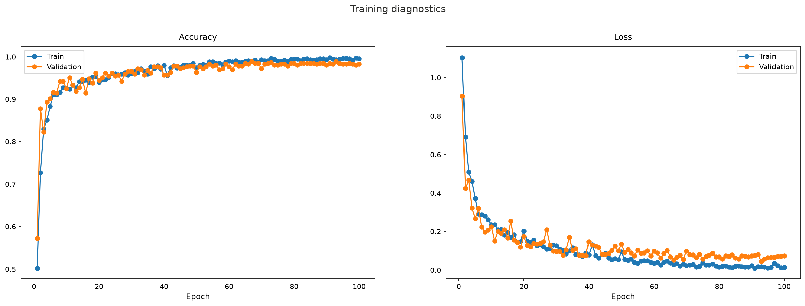

# Rose Leaf Classification with a Basic CNN

A simple Convolutional Neural Network (CNN), built from scratch in **PyTorch**, that classifies rose-leaf photos into 4 classes: **Black Spot**, **Dry Leaf**, **Healthy Leaf** and **Leaf Holes**.


## Dataset

**RoseLeafSet: Real-World Leaf Image Dataset for AI-Based Agricultural Solutions** (Mendeley Data)
🔗 https://data.mendeley.com/datasets/9g668bfhy5/3

The dataset comes in four versions (Original, Processed JPG, Processed PNG, Augmented). This project uses the **Processed Image** version: 3,114 photos with the background removed (white), the leaf cropped and centred, 2024×2024 JPG.

| Class | Images |
|---|---|
| BlackSpot | 1288 |
| DryLeaf | 324 |
| HealthyLeaf | 819 |
| LeafHoles | 683 |
| **Total** | **3114** |

The classes are **imbalanced** (DryLeaf has the fewest images), so per-class precision / recall / F1 are reported along with accuracy.


## Project structure

```
CNN_implementation/
├── CNN.ipynb                  # the full notebook (data → model → training → evaluation)
├── README.md
├── .gitignore
├── RoseLeafSet/               # original 2024×2024 images (download, not in repo)
│   ├── BlackSpot/
│   ├── DryLeaf/
│   ├── HealthyLeaf/
│   └── LeafHoles/
└── RoseLeafSet Image_128/     # 128×128 copies, created automatically by the notebook
```

---

## Setup

1. **Get the data:** download the dataset, take the `Processed Image` folder and rename it to `RoseLeafSet/`. Rename its sub-folders to `BlackSpot`, `DryLeaf`, `HealthyLeaf` and `LeafHoles` (remove the `Processed_` prefix). Put it next to `CNN.ipynb`.

2. **Create the environment** (example with conda):

   ```bash
   conda create -n CVPR python=3.14
   conda activate CVPR

   # PyTorch with CUDA (NVIDIA GPU) — use the CPU build from pytorch.org if you have no GPU
   pip install torch torchvision --index-url https://download.pytorch.org/whl/cu128

   pip install matplotlib scikit-learn seaborn torchsummary ipykernel pillow numpy
   ```

3. **Run** `CNN.ipynb` top to bottom (VS Code or Jupyter, with the `CVPR` kernel).
   The first run resizes every image once to 128×128 and saves the copies in `RoseLeafSet Image_128/`; later runs skip this step.

---

## Pipeline

1. **Resize once:** 2024×2024 → 128×128, so training does not decode large JPGs every epoch.
2. **Load** with `torchvision.datasets.ImageFolder` (labels come from the folder names).
3. **Split** into **70% train / 15% validation / 15% test**, stratified by class (`random_state=42`).
   - Train: 2,179 · Validation: 467 · Test: 468
4. **Augment** the training set only:
   - random horizontal and vertical flip
   - random rotation ±20° (corners filled with white)
   - brightness / contrast jitter
5. **Train** the CNN and keep the weights from the epoch with the best validation accuracy.
6. **Evaluate** on the test set: accuracy, classification report, confusion matrix, misclassified images.

---

## Model architecture

Four blocks of `Conv 3×3 → MaxPool 2×2 → ReLU`, followed by a fully connected classification head.

| Layer | Output shape |
|---|---|
| Input | 3 × 128 × 128 |
| Conv2d(3→64, 3×3) → MaxPool → ReLU | 64 × 63 × 63 |
| Conv2d(64→64, 3×3) → MaxPool → ReLU | 64 × 30 × 30 |
| Conv2d(64→128, 3×3) → MaxPool → ReLU | 128 × 14 × 14 |
| Conv2d(128→128, 3×3) → MaxPool → ReLU | 128 × 6 × 6 |
| Flatten | 4608 |
| Linear(4608→256) → ReLU → **Dropout(0.5)** | 256 |
| Linear(256→4) | 4 (class scores) |

**Total trainable parameters:** 1,441,092

---

## Training settings

| Setting | Value |
|---|---|
| Input size | 128 × 128 RGB |
| Batch size | 32 |
| Epochs | 100 |
| Optimizer | Adam |
| Learning rate | 0.001 → 0.0001 |
| LR scheduler | Cosine Annealing (`CosineAnnealingLR`) |
| Loss function | Cross-Entropy |
| Regularization | Dropout (0.5) + data augmentation |
| Model selection | best validation accuracy (saved as `cnn_best.pth`) |

---

## Results

| Metric | Value |
|---|---|
| Best validation accuracy | 98.93% (epoch 67) |
| Best validation loss | 0.0454 (epoch 93) |
| Best training loss | 0.0093 (epoch 91) |
| **Test accuracy** | **97.65%** (457 / 468 correct) |
| Test macro F1-score | 0.9697 |

### Per-class results (test set)

| Class | Precision | Recall | F1-score | Test images |
|---|---|---|---|---|
| BlackSpot | 0.9745 | 0.9845 | 0.9795 | 194 |
| DryLeaf | 0.9773 | 0.8958 | 0.9348 | 48 |
| HealthyLeaf | 0.9685 | 1.0000 | 0.9840 | 123 |
| LeafHoles | 0.9901 | 0.9709 | 0.9804 | 103 |

**DryLeaf**, the smallest class, has the lowest recall (89.6%): about 1 in 10 dry leaves is predicted as another class. Every **HealthyLeaf** test image was classified correctly.

### Training curves



The notebook also shows a confusion matrix of the test set and a grid of the misclassified test images.

---

## Tech stack

Python · PyTorch · torchvision · scikit-learn · NumPy · Matplotlib · Seaborn · Pillow
